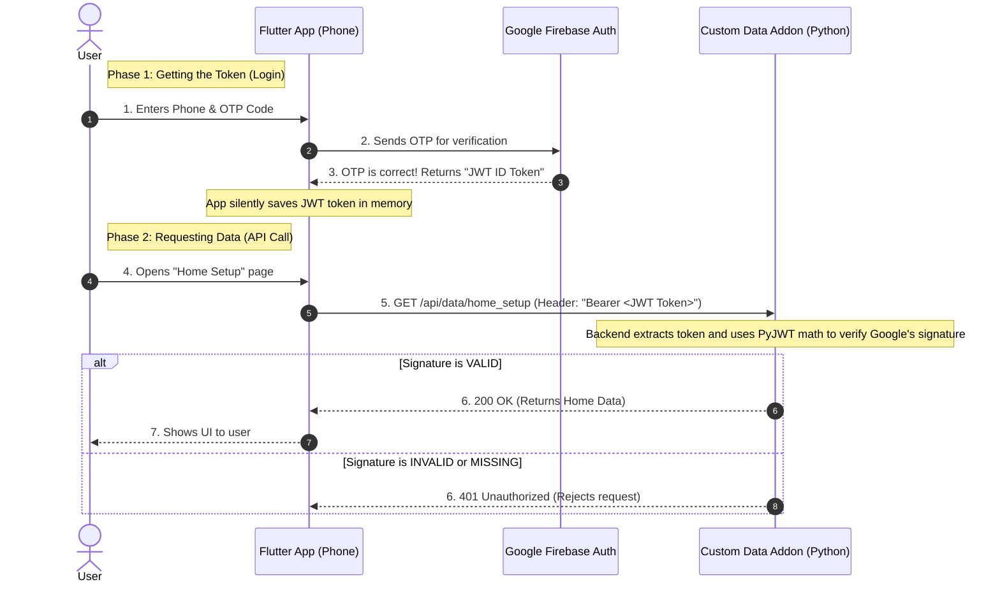

# JWT Security Architecture: A Simple Guide

Here is a simple, visual flow of exactly how the pieces of your app work together to keep your data secure.

## The Architecture Diagram

---

## Who Does What Job?

Think of it like a secure VIP nightclub:

### 1. The Flutter App (The Guest)
**Job:** Needs to get inside the club to get data.
It goes to the bouncer (Firebase), proves its identity with an SMS code, gets a VIP Wristband (JWT Token), and then shows that wristband at the VIP Door (Your Python Addon).

### 2. Google Firebase (The Ticket Office / Bouncer)
**Job:** Issues the secure VIP Wristbands.
It is the only entity that can send SMS codes. When it proves a user is real, it creates the JWT Token, stamps it with an expiration time (1 hour), and mathematically signs it using a top-secret private key.

### 3. Custom Data Addon / Python Backend (The VIP Door Guard)
**Job:** Protects your data and checks the wristbands.
When the Flutter App asks for data, the backend looks at the JWT token. It **never** talks to Firebase directly to check the token. Instead, it uses simple math (`PyJWT`) and Google's public keys to instantly verify:
1. Was this token signed by Google?
2. Has it been less than 1 hour since it was created?
If both are true, it opens the door and hands over the SQLite data. If not, it slams the door (`401 Unauthorized`).
